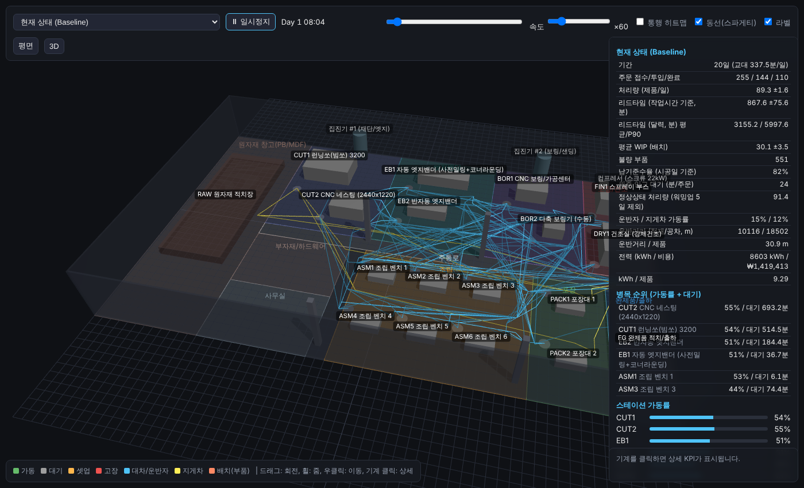

# factory-twin — 가구 공장 디지털 트윈 프로토타입

실제 가구 공장을 온라인에 복제해 병목·비효율·설비 투자·레이아웃·인력 배치·동선을 시뮬레이션으로 평가하기 위한 시작점. **무엇을 조사해서 어디에 넣으면 복제가 되는지, 복제가 맞는지 어떻게 검증하는지는 `docs/03_공장복제_명세서.md`가 기준.** 리서치 종합은 `docs/00_종합보고서.md`, 방문 당일 시간표·장비는 `docs/01_현장방문_체크리스트.md`.

```bash
./run.sh                      # 샘플 공장 생성 → 5 시나리오 시뮬레이션 → http://localhost:8000/viewer/
# 또는
python3 data/build_sample.py
python3 sim/compare.py --seeds 5          # sim/out/comparison.md, sim/out/<scenario>/{events.jsonl,kpis.json}
python3 -m http.server 8000               # viewer/index.html 열기
```

실제 공장 데이터로 바꾸기: `capture/templates/현장수집_템플릿.xlsx` 작성 → `python3 tools/templates_to_json.py <xlsx> data/my_factory.json` → `python3 sim/compare.py --factory data/my_factory.json`.

| 디렉터리 | 내용 |
|---|---|
| `schema/` | factory.json 데이터 모델 |
| `data/` | 샘플 공장(가상 추정치) |
| `capture/templates/` | 현장 수집 xlsx 템플릿 |
| `sim/` | SimPy 이산사건 시뮬레이션, A* 경로, 시나리오 비교 |
| `scenarios/` | what-if 패치 (설비 추가·교체, 배치 크기, 레이아웃, SMED) |
| `viewer/` | Three.js 3D 트윈 뷰어 (로컬 번들, 서버만 있으면 동작) |
| `docs/` | 종합 보고서, 체크리스트, 아키텍처, 리서치 원문 6건, 스크린샷 |


